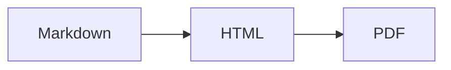

# Démo md2pdf

Texte en **gras**, *italique*, ~~barré~~, `code`, lien https://example.com et un emoji 🚀 — avec des "guillemets" typographiques.

## Listes

- élément
  - imbriqué
1. un
2. deux

- [x] tâche faite
- [ ] tâche à faire

## Tableau

| Colonne | Alignée à droite | Centrée |
|:--------|-----------------:|:-------:|
| a       | 1,00 €           | ✓       |
| b       | 12,50 €          | ✗       |

## Code

```python
def fib(n: int) -> int:
    return n if n < 2 else fib(n - 1) + fib(n - 2)
```

> Une citation
> sur plusieurs lignes.

## Maths

Inline $e^{i\pi} + 1 = 0$ et en bloc :

$$
\int_0^\infty e^{-x^2}\,dx = \frac{\sqrt{\pi}}{2}
$$

## Mermaid



Terme
: Définition du terme.

Une note de bas de page[^1].

[^1]: Contenu de la note.
